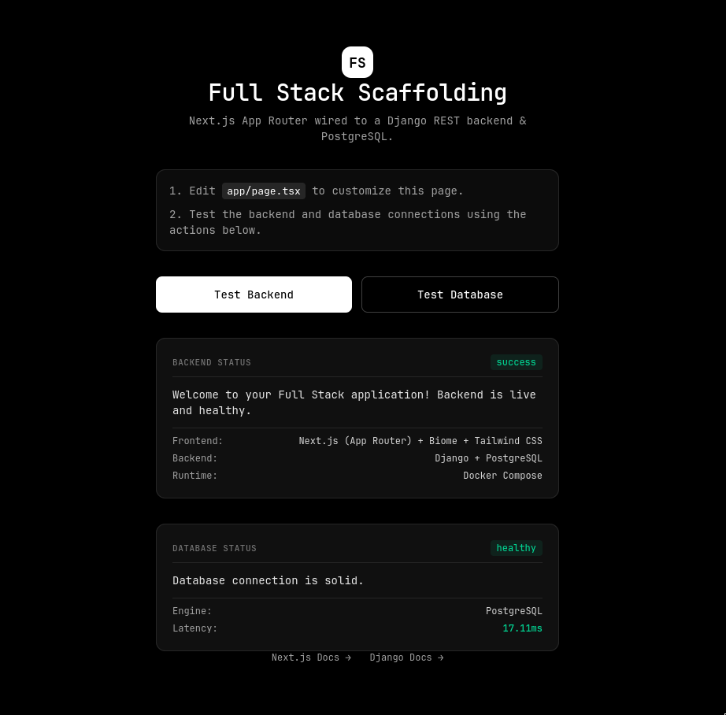

# Full Stack Scaffolding

A full stack starter: a **Next.js (App Router)** frontend wired to a **Django REST** backend and a **PostgreSQL** database, all running with **Docker Compose**.



## Tech Stack

| Layer     | Technology                                  |
| --------- | ------------------------------------------- |
| Frontend  | Next.js (App Router), Tailwind CSS, Biome   |
| Backend   | Django + Django REST Framework              |
| Database  | PostgreSQL 16 (Alpine)                      |
| Runtime   | Docker Compose                              |
| Packages  | pnpm (frontend), pip (backend)              |

## Project Structure

```
.
├── backend/              # Django project (REST API)
│   └── Dockerfile
├── frontend/             # Next.js app (App Router)
│   ├── app/page.tsx      # Home page, edit this to get started
│   └── Dockerfile
├── docker-compose.yml
├── .env                  # Local environment variables (not committed)
└── README.md
```

## Prerequisites

- [Docker](https://docs.docker.com/get-docker/) and Docker Compose v2

That's all you need to run the project. Node.js, pnpm and Python are only required if you want to run the services outside Docker.

## Getting Started

### 1. Clone the repository

```bash
git clone https://github.com/bkaztaou/fs-app
cd fs-app
```

### 2. Configure environment variables

Create a `.env` file at the project root:

```env
# PostgreSQL
POSTGRES_DB=app_db
POSTGRES_USER=app_user
POSTGRES_PASSWORD=change_me
POSTGRES_PORT=5432

# Django
DJANGO_DEBUG=1
DJANGO_SECRET_KEY=change_me_to_a_long_random_string
DATABASE_URL=postgres://app_user:change_me@db:5432/app_db

# Next.js
NEXT_PUBLIC_API_URL=http://localhost:8000
```

> **Note:** Inside Docker, the database host is the service name `db`, not `localhost`. Keep the credentials in `DATABASE_URL` consistent with the `POSTGRES_*` values.

### 3. Build and start everything

```bash
docker compose up --build
```

### 4. Open the app

| Service     | URL                      |
| ----------- | ------------------------ |
| Frontend    | http://localhost:3000    |
| Backend API | http://localhost:8000    |
| PostgreSQL  | `localhost:5432`         |

On the home page, use the **Test Backend** and **Test Database** buttons to confirm that the API and the database connection are healthy.

## Environment Variables

| Variable              | Used by  | Default                 | Description                                  |
| --------------------- | -------- | ----------------------- | -------------------------------------------- |
| `POSTGRES_DB`         | db       | none (required)         | Database name                                |
| `POSTGRES_USER`       | db       | none (required)         | Database user                                |
| `POSTGRES_PASSWORD`   | db       | none (required)         | Database password                            |
| `POSTGRES_PORT`       | db       | `5432`                  | Port exposed on the host                     |
| `DJANGO_DEBUG`        | backend  | `1`                     | Django debug mode (`1` on, `0` off)          |
| `DJANGO_SECRET_KEY`   | backend  | none (required)         | Django secret key                            |
| `DATABASE_URL`        | backend  | none (required)         | Connection string used by Django             |
| `NEXT_PUBLIC_API_URL` | frontend | `http://localhost:8000` | Base URL the browser uses to reach the API   |

## Services

### `db` (PostgreSQL)
- Image: `postgres:16-alpine`
- Data is persisted in the named volume `postgres_data`.
- A healthcheck (`pg_isready`) runs every 5 seconds; the backend waits until the database is healthy before starting.

### `backend` (Django)
- Runs `python manage.py runserver 0.0.0.0:8000`.
- The `./backend` directory is mounted into the container, so code changes reload automatically.

### `frontend` (Next.js)
- Runs `pnpm dev`.
- The `./frontend` directory is mounted into the container for hot reload. `node_modules` is kept inside the container via an anonymous volume.

## Common Commands

```bash
# Start in the background
docker compose up -d

# Follow logs (all services, or a single one)
docker compose logs -f
docker compose logs -f backend

# Stop services
docker compose down

# Stop services AND delete the database volume (destroys all data)
docker compose down -v

# Rebuild after changing dependencies or Dockerfiles
docker compose up --build
```

### Django

```bash
# Apply migrations
docker compose exec backend python manage.py migrate

# Create new migrations after changing models
docker compose exec backend python manage.py makemigrations

# Create an admin user
docker compose exec backend python manage.py createsuperuser

# Run tests
docker compose exec backend python manage.py test
```

### Frontend

```bash
# Install a new package
docker compose exec frontend pnpm add <package>

# Lint and format with Biome
docker compose exec frontend pnpm exec biome check .
docker compose exec frontend pnpm exec biome check --write .
```

### Database

```bash
# Open a psql shell
docker compose exec db psql -U $POSTGRES_USER -d $POSTGRES_DB
```

## Customizing

1. Edit `frontend/app/page.tsx` to change the home page.
2. Add your Django apps and API endpoints in `backend/`.
3. Replace the placeholder values in `.env` with your own credentials.

## Troubleshooting

- **Port already in use:** change `POSTGRES_PORT` in `.env`, or stop whatever is using ports `3000` / `8000`.
- **Backend can't connect to the database:** make sure `DATABASE_URL` uses host `db` and matches the `POSTGRES_*` credentials. If you changed the credentials after the first run, reset the volume with `docker compose down -v`.
- **Frontend can't reach the API:** check that `NEXT_PUBLIC_API_URL` points to an address reachable from your **browser** (usually `http://localhost:8000`), and that CORS is configured in Django for `http://localhost:3000`.
- **Changed dependencies but nothing happens:** rebuild with `docker compose up --build`.

## Production Notes

This setup is intended for **development**. Before deploying:

- Set `DJANGO_DEBUG=0` and use a strong, unique `DJANGO_SECRET_KEY`.
- Replace `runserver` with a production server such as Gunicorn.
- Build the frontend (`pnpm build` / `pnpm start`) instead of running `pnpm dev`.
- Don't expose the PostgreSQL port publicly, and never commit `.env`.

---

## Ecosystem and Scaling Guide

`create-fs-app` intentionally ships without heavy business logic dependencies such as authentication, payments, or websockets. Every project is unique, and forcing a specific authentication provider or UI library on day one usually means deleting more code later than you would have written by choosing it yourself.

This guide covers two things. First, the foundational tools that almost every serious project ends up needing, regardless of what it does. Second, a breakdown by project type (ecommerce, SaaS, marketplace, content platform, internal tool) so you can pick the right additions for what you are actually building, and understand why they fit.

### Foundational Additions (Apply to Almost Any Project)

These are less about what your product does and more about keeping the codebase healthy as it grows. Most projects should adopt these early rather than waiting until pain forces the issue.

**Frontend**

- **UI Components:** [shadcn/ui](https://ui.shadcn.com/) or [Radix UI](https://www.radix-ui.com/). Both are unstyled and accessible, and integrate cleanly with the Tailwind CSS setup already included, without the bloat of a full component library you would otherwise need to override.
- **State Management:** Avoid reaching for Redux by default. [Zustand](https://github.com/pmndrs/zustand) covers most global state needs with far less boilerplate, and only introduce something heavier once you have a concrete reason to.
- **Forms and Validation:** [React Hook Form](https://react-hook-form.com/) paired with [Zod](https://zod.dev/) gives you type safe, performant client side validation that mirrors the validation you will also want on the Django side, so the same schema logic can guide both.
- **Data Fetching:** The included `ApiClient` built on native `fetch` is fine for most server rendered pages. Once you need polling, cache invalidation, optimistic updates, or infinite scrolling, wrap it with [TanStack Query](https://tanstack.com/query/latest) rather than rebuilding that logic by hand.

**Backend**

- **Authentication:** [Django REST Framework SimpleJWT](https://django-rest-framework-simplejwt.readthedocs.io/en/latest/) for standard token based auth, or [Django Allauth](https://docs.allauth.org/) once you need social logins such as Google or GitHub.
- **Background Tasks:** Anything slow (sending emails, resizing images, calling a third party API) should not block a request response cycle. [Celery](https://docs.celeryq.dev/) backed by Redis is the standard choice in the Django ecosystem.
- **Testing:** [pytest-django](https://pytest-django.readthedocs.io/) tends to scale better than Django's built in test runner once you have more than a handful of test files, and works well alongside [factory_boy](https://factoryboy.readthedocs.io/) for generating test data.
- **Monitoring and Errors:** [Sentry](https://sentry.io/) has first class SDKs for both Django and Next.js. Wiring it in early means you catch production issues before users report them, rather than after.

With that foundation in mind, here is how the picture changes depending on what you are building.

### If You Are Building an Ecommerce Platform

The defining concerns of ecommerce are catalog complexity, payment correctness, and inventory consistency. Data integrity matters more here than in almost any other category, since money and stock counts are involved.

- **Payments:** The [Stripe Python SDK](https://github.com/stripe/stripe-python) integrates directly with Django views. Use Stripe Webhooks, not client side confirmation, to update order and payment status in your database, since webhooks are the only source of truth you can trust for whether a payment actually succeeded.
- **Product Catalog and Search:** Once your catalog grows past a few hundred products, PostgreSQL's full text search will start to feel limited for filtering and faceted search. [Meilisearch](https://www.meilisearch.com/) is lightweight to self host and pairs well with a Docker Compose setup like this one, while [Elasticsearch](https://www.elastic.co/) suits larger catalogs with more complex search requirements.
- **Inventory and Order State:** Model orders as an explicit state machine (pending, paid, fulfilled, refunded) rather than a collection of boolean flags. [django-fsm](https://github.com/viewflow/django-fsm) enforces valid state transitions and prevents an order from silently ending up in an inconsistent state.
- **Media and Images:** Product photos should not live in your application containers. Use [django-storages](https://django-storages.readthedocs.io/) with an S3 compatible bucket, so image storage scales independently of your app servers and survives container rebuilds.
- **Caching:** Product listing and category pages are read heavy and change infrequently. Redis backed caching on the Django side, combined with Next.js's built in fetch caching, reduces database load significantly during traffic spikes such as sales events.

### If You Are Building a SaaS Product

SaaS projects are defined by multi tenancy, subscription billing, and the need to iterate quickly on features without breaking existing customers.

- **Multi Tenancy:** If you need to isolate customer data by organization or team, decide early whether you want row level tenancy (a `tenant_id` foreign key on shared tables) or schema level tenancy. [django-tenants](https://django-tenants.readthedocs.io/) implements schema level isolation using PostgreSQL schemas, which gives stronger data isolation but adds migration complexity, so row level tenancy is often the simpler starting point for smaller teams.
- **Subscription Billing:** [Stripe Billing](https://stripe.com/billing) handles recurring subscriptions, proration, and dunning management, which are all things you do not want to build yourself. Combine it with Stripe Webhooks to keep subscription status in sync with your database.
- **Feature Flags:** As you add plans and tiers, you will want to gate features without deploying new code every time. [Unleash](https://www.getunleash.io/) or a simpler self rolled flags table both work, depending on how much flexibility you need.
- **Authentication for Teams:** Beyond basic auth, SaaS apps typically need invitations, roles, and permissions per organization. Building this on top of Django Allauth with a custom membership model is usually more maintainable than trying to force a generic permissions library to fit a team based structure.
- **Usage Metering:** If pricing is usage based (API calls, seats, storage), track usage events in a dedicated table or send them to a service like [Stripe Meters](https://stripe.com/blog/usage-based-billing) rather than computing usage on the fly from application logs.

### If You Are Building a Content Platform or Marketplace

These projects (blogs, community platforms, two sided marketplaces) are usually defined by high read volume, user generated content, and the need for real time or near real time interaction between users.

- **Real Time Features:** For chat, live notifications, or live bidding, install [Django Channels](https://channels.readthedocs.io/en/latest/) and add a Redis container to `docker-compose.yml`. Channels integrates with Django's existing authentication and ORM, so you are not maintaining a separate real time service.
- **Rich Text and Media:** [django-ckeditor](https://github.com/django-ckeditor/django-ckeditor) or a headless approach with [Tiptap](https://tiptap.dev/) on the frontend both work well. Tiptap is the better fit if you want full control over the editor's appearance and behavior within the existing Next.js and Tailwind setup.
- **Content Moderation:** User generated content at scale eventually needs moderation tooling, even if it starts manual. Building an admin review queue directly on top of Django's admin interface is often faster than adopting a dedicated moderation platform early on.
- **Search and Discovery:** Same recommendation as ecommerce: Meilisearch for a lightweight self hosted option, Elasticsearch if you need more advanced ranking and filtering at larger scale.
- **CDN and Caching:** Marketplaces and content sites benefit heavily from caching rendered pages at the edge. Since Next.js is already in the stack, deploying the frontend behind a CDN with route level caching handles most of this without extra backend work.

### If You Are Building an Internal Tool or Admin Dashboard

Internal tools have different priorities than public facing products. Development speed and low maintenance overhead usually matter more than polish or extreme scalability.

- **Admin Interface:** Lean on Django's built in admin as much as possible. Libraries like [django-unfold](https://github.com/unfoldadmin/django-unfold) modernize its appearance without you needing to build a custom frontend for basic CRUD screens.
- **Authentication:** Internal tools are a good candidate for single sign on rather than username and password accounts. Django Allauth supports SAML and OAuth providers, which is usually the right fit if your company already uses Google Workspace or Okta.
- **Data Tables and Reporting:** For internal dashboards, [TanStack Table](https://tanstack.com/table/latest) on the frontend handles sorting, filtering, and pagination for large datasets without needing a dedicated business intelligence tool.
- **Lower Priority:** Things like aggressive caching, CDN placement, and horizontal scaling are usually unnecessary here, since internal tools have a small, known user base. Spending time on these early is often wasted effort compared to public facing products.

### General Scaling Principles

A few things apply regardless of which category above best describes your project.

- **Database first, cache second.** Before reaching for Redis or a search engine, confirm your PostgreSQL queries are actually indexed properly and your Django querysets are not causing N plus one queries. [django-debug-toolbar](https://django-debug-toolbar.readthedocs.io/) makes this visible quickly during development.
- **Separate your Docker Compose environments.** As you add services like Redis or Celery workers, keep a distinct `docker-compose.prod.yml` rather than trying to make one file serve both development and production, since the two have very different needs around volumes, restart policies, and secrets.
- **Introduce a task queue before you think you need one.** Celery is easier to add to a project with a handful of endpoints than to retrofit onto one with dozens of views calling slow external services synchronously.
- **Keep the frontend and backend independently deployable.** Even though this template ships them together for local development, plan your production deployment so the Next.js frontend and Django backend can be scaled and released independently once traffic demands it.

---

## Resources

- [Next.js Documentation](https://nextjs.org/docs)
- [Django Documentation](https://docs.djangoproject.com/)
- [Django REST Framework](https://www.django-rest-framework.org/)
- [PostgreSQL Documentation](https://www.postgresql.org/docs/)
- [Docker Compose Documentation](https://docs.docker.com/compose/)
